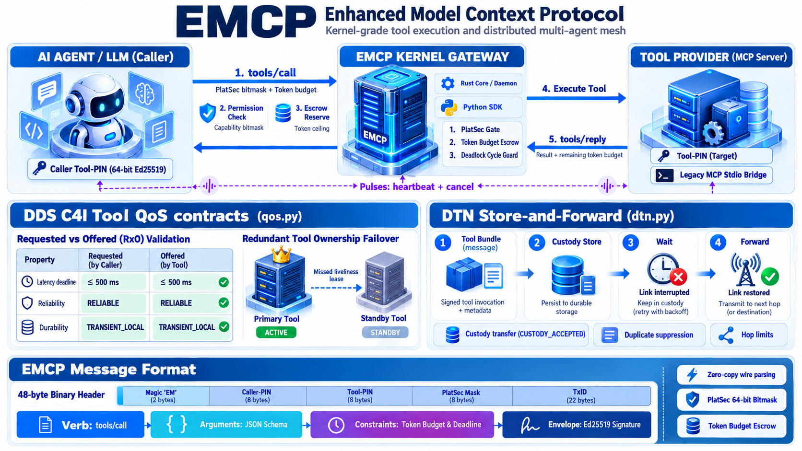

# EMCP: Enhanced Model Context Protocol

[](LICENSE)


[](https://mrschneider.github.io/emcp/)

**EMCP** (Enhanced Model Context Protocol) is a kernel-grade tool execution and multi-agent mesh protocol. While Anthropic's standard MCP standardizes *how tools are described* (via JSON Schema), EMCP standardizes *how tools are executed with strict operating-system guarantees*: cryptographic capability bitmasks, upfront token budget escrow, sub-millisecond zero-copy wire framing, DDS C4I high-availability failover, and disruption-tolerant delivery.



---

## Why EMCP? (The Breakdown of Standard MCP)

Standard MCP treats tool execution as conversational JSON-RPC 2.0 text over `stdio` or SSE. In production multi-agent environments, this design creates critical failure modes:

1. **Ambient Authority & Prompt Injection:** Standard MCP has no protocol-level capability checks. If an LLM is manipulated via prompt injection into calling a registered filesystem or bash tool, the tool executes with the host process's full permissions.
2. **Context Blowup & Token Exhaustion:** Tools can return unbounded payloads (e.g. 500 KB logs), instantly detonating the LLM's context window and burning API budgets without prior reservation.
3. **Pass-Fail Networking & Lost Results:** If a remote or edge tool link drops during a heavy invocation, the request is aborted with `Connection reset` and expensive compute is lost.
4. **Single Instance Point of Failure:** Standard MCP assumes a tool is single-instance. If that tool process dies, the agent fails with no fallback.
5. **Serialization Overhead:** JSON-RPC string escaping on high-frequency tools (telemetry, vector search, databases) introduces tail-latency spikes and GC jitter.

---

## MCP vs. EMCP Comparison

| Feature | Standard MCP (Anthropic) | EMCP (Enhanced) | Operational Impact |
| :--- | :--- | :--- | :--- |
| **Wire Protocol** | JSON-RPC 2.0 text over stdio/SSE | Fixed **48-byte binary header** + 4 structured slots | Microsecond transit, zero-copy socket parsing |
| **Security Gate** | None (ambient authority) | **Symbian PlatSec 64-bit Bitmask** | Unprivileged frames denied at wire layer before LLM/tool wakes up |
| **Cost Control** | Unbounded output | **Upfront Token Budget Escrow** | Prevents context explosion with automatic ledger rollback |
| **Addressing** | Local `stdio` or transient `host:port` | **64-bit Cryptographic Tool-PIN** | Tools addressed by Ed25519 identity, mobile across nodes/edges |
| **High Availability** | Single instance point-of-failure | **DDS C4I Tool QoS & Ownership** | Automatic failover to replica tool instances upon missed liveliness lease |
| **Resiliency** | Fragile connection reset | **RFC 9171 DTN Custody Transfer** | Offline buffering with atomic custody handover (`CUSTODY_ACCEPTED`) |
| **Deadlock Guard** | Silent hanging | **QNX Deadlock Graph Engine** | Prevents circular tool/subagent recursion (`A → B → A`) |
| **Legacy Compatibility** | N/A | **`McpStdioProcessAdapter` Bridge** | Spawns standard MCP servers over `stdio` without code modifications |

---

## Interactive Playground

- **Live Web Playground:** [mrschneider.github.io/emcp](https://mrschneider.github.io/emcp/) (interactive browser simulator testing PlatSec gates, budget sliders, redundant tool failover, and 48-byte hex wire framing).
- **Terminal CLI Playground:** Run directly in your shell against a live child MCP process over OS stdio pipes:
  ```bash
  python3 playground.py
  ```

---

## Key Architectural Pillars

### 1. Platform Security Gate (Symbian PlatSec)
Every EMCP frame carries a 64-bit capability bitmask. Tools declare their `required_caps`. The gate validates:
$$\text{EffectiveGranted} \ \& \ \text{Required} == \text{Required}$$
If the caller lacks the required capability bit (e.g. `CAP_DATABASE_MUTATE` on `drop_database`), execution aborts immediately at the transport layer with `EMCP_ERR_CAPABILITY_DENIED (3)`. **The underlying tool process or database is never touched.**

### 2. Upfront Token Budget Escrow (`budget.py`)
Callers specify an explicit `token_budget` in Slot 2. The server reserves this budget in a `TokenBudgetLedger` *before* invoking the handler. As output is generated, the ledger meters tokens in flight. If the output exceeds the ceiling:
- The transaction aborts with `EMCP_ERR_TOKEN_OVERFLOW (7)`;
- The reserved capacity is refunded in full to the ledger;
- The LLM receives a clean error instead of having its context window contaminated.

### 3. Distributed Tool High-Availability via DDS QoS (`qos.py`)
- **Requested vs. Offered (RxO) Contracts:** Callers declare required SLA deadlines and reliability guarantees. If a tool cannot satisfy the contract, the binding is rejected upfront.
- **Exclusive Ownership with Automatic Failover:** Multiple tool instances register for the same tool name with an `ownership_strength` (0..1000). If the active primary tool misses its liveliness heartbeat lease, incoming calls automatically route to the replica standby tool without breaking agent workflows.
- **Turnaround Deadline Monitoring:** `ToolDeadlineMonitor` detects slow queries and triggers out-of-band cancellation pulses (`PULSE_CANCEL`).

### 4. Disruption-Tolerant Tool Execution via DTN (`dtn.py`)
For tools operating on edge nodes, mobile robots, or unstable WAN links:
- Invocations are wrapped in RFC 9171 `ToolBundle`s with store-and-forward custody;
- When a link drops mid-call, the bundle remains in the local `ToolCustodyStore`;
- Upon link restoration, the frame is delivered, and the upstream node releases local memory only after receiving `CustodySignal.CUSTODY_ACCEPTED`.
- Duplicate suppression rings prevent accidental double-execution of non-idempotent tools.

### 5. Seamless Anthropic MCP Bridge (`adapter_mcp.py`)
`McpStdioProcessAdapter` wraps any existing Anthropic MCP server (Python, Node/TypeScript, Go) executing over `stdio`:
- Launches the server binary via `subprocess.Popen`;
- Performs the JSON-RPC 2.0 `initialize` handshake and queries `tools/list`;
- Automatically binds all tools into EMCP with assigned PlatSec capability requirements;
- Intercepts calls, validates capabilities, and meters token budgets before writing to the subprocess's `stdin`.

---

## Quickstart & Code Examples

### 1. Creating a Native EMCP Tool Server

```python
import asyncio
from emcp import EmcpServer, Capability

server = EmcpServer(
    name="production-tools",
    allowed_capabilities=Capability.CAP_READ_FS | Capability.CAP_DATABASE_QUERY
)

@server.tool(
    name="query_users",
    description="Executes a read-only SQL query",
    required_caps=Capability.CAP_DATABASE_QUERY,
    default_max_tokens=1000
)
def query_users(sql: str):
    return {"rows": [{"id": 42, "username": "alice"}]}

@server.tool(
    name="drop_table",
    description="Destructive DDL action",
    required_caps=Capability.CAP_DATABASE_MUTATE,
    default_max_tokens=200
)
def drop_table(table_name: str):
    return {"status": "table dropped"}
```

### 2. Invoking Tools with PlatSec & Budget Protection

```python
from emcp import EmcpClient, Capability, EmcpError

async def main():
    # Client possessing only read capabilities
    client = EmcpClient(allowed_capabilities=Capability.CAP_DATABASE_QUERY)

    # 1. Authorized read call succeeds
    reply = await client.call_tool(server, "query_users", {"sql": "SELECT 1"}, token_budget=500)
    print("Result:", reply.args)
    print("Remaining budget in envelope:", reply.constraints.token_budget)

    # 2. Unauthorized destructive call is blocked by PlatSec (handler never runs!)
    attack_reply = await client.call_tool(server, "drop_table", {"table_name": "users"})
    print("Status:", attack_reply.status) # EmcpError.EMCP_ERR_CAPABILITY_DENIED (3)

asyncio.run(main())
```

### 3. Wrapping Legacy Anthropic MCP Servers over Stdio

Spawn existing MCP servers (e.g., standard SQLite, GitHub, or Postgres MCP servers) as child OS processes:

```python
import sys
from emcp import McpStdioProcessAdapter, Capability

# Map legacy tool names to EMCP PlatSec bitmasks
tool_caps = {
    "read_query": Capability.CAP_DATABASE_QUERY,
    "write_query": Capability.CAP_DATABASE_MUTATE,
}

adapter = McpStdioProcessAdapter(
    name="legacy-mcp-db",
    command=[sys.executable, "path/to/legacy_mcp_server.py"],
    tool_capabilities=tool_caps,
    allowed_capabilities=Capability.CAP_DATABASE_QUERY | Capability.CAP_DATABASE_MUTATE,
)

# Use adapter directly as an EMCP server
client = EmcpClient(allowed_capabilities=Capability.CAP_DATABASE_QUERY)
reply = await client.call_tool(adapter, "read_query", {"query": "SELECT * FROM items"})
adapter.close()
```

### 4. High-Availability Redundant Tool Failover via DDS QoS

```python
from emcp.qos import ToolOwnershipArbitrator

arbitrator = ToolOwnershipArbitrator()
tool_name = "weather_sensor"

# Node .70 primary (strength 200), Node .18 backup (strength 100)
arbitrator.register_candidate(tool_name, tool_pin=0x7070_1111, strength=200, lease_ms=5000)
arbitrator.register_candidate(tool_name, tool_pin=0x1818_2222, strength=100, lease_ms=5000)

# Routes to primary tool
print("Active tool:", hex(arbitrator.get_owner(tool_name))) # 0x70701111

# When primary misses liveliness heartbeat (> 5000ms), failover is instantaneous:
print("Failover tool:", hex(arbitrator.get_owner(tool_name, now=10000.0))) # 0x18182222
```

---

## Wire Format Specification

All EMCP frames are serialized in big-endian network byte order. A fixed **48-byte header** precedes a structured 4-slot payload:

```
 0                   1                   2                   3
 0 1 2 3 4 5 6 7 8 9 0 1 2 3 4 5 6 7 8 9 0 1 2 3 4 5 6 7 8 9 0 1
+-+-+-+-+-+-+-+-+-+-+-+-+-+-+-+-+-+-+-+-+-+-+-+-+-+-+-+-+-+-+-+-+
|          Magic (0x45, 0x4D)   |  Ver (0x01)   |  MsgType (8b) |
+-+-+-+-+-+-+-+-+-+-+-+-+-+-+-+-+-+-+-+-+-+-+-+-+-+-+-+-+-+-+-+-+
|            OpCode (16b)       |         Flags (16b)           |
+-+-+-+-+-+-+-+-+-+-+-+-+-+-+-+-+-+-+-+-+-+-+-+-+-+-+-+-+-+-+-+-+
|                       Caller PIN (64b)                        |
+-+-+-+-+-+-+-+-+-+-+-+-+-+-+-+-+-+-+-+-+-+-+-+-+-+-+-+-+-+-+-+-+
|                     Target Tool-PIN (64b)                     |
+-+-+-+-+-+-+-+-+-+-+-+-+-+-+-+-+-+-+-+-+-+-+-+-+-+-+-+-+-+-+-+-+
|                     Transaction ID / UUID (64b)               |
+-+-+-+-+-+-+-+-+-+-+-+-+-+-+-+-+-+-+-+-+-+-+-+-+-+-+-+-+-+-+-+-+
|                   PlatSec Capability Mask (64b)               |
+-+-+-+-+-+-+-+-+-+-+-+-+-+-+-+-+-+-+-+-+-+-+-+-+-+-+-+-+-+-+-+-+
|  Status / Error Code (32b)    |  Payload Length (32b)         |
+-+-+-+-+-+-+-+-+-+-+-+-+-+-+-+-+-+-+-+-+-+-+-+-+-+-+-+-+-+-+-+-+
```

Payload slots:
- **Slot 0 (`Verb`):** UTF-8 method (`tools/call`, `tools/list`, `resources/read`).
- **Slot 1 (`Arguments`):** Arguments JSON Schema or tool response payload.
- **Slot 2 (`Constraints`):** `token_budget` (uint32), `timeout_ms` (uint32), `max_depth_hops` (uint8).
- **Slot 3 (`Envelope`):** `session_handle` (uint32) + Ed25519 digital signature.

---

## Directory Layout

```
.
├── ARCHITECTURE.md          # Canonical EMCP Specification (Layers, PlatSec, Wire)
├── README.md                # Overview, Comparison & Quickstart
├── playground.py            # Interactive CLI playground over live stdio pipes
├── pyproject.toml           # Python SDK packaging
├── crates/
│   ├── emcp-core/           # Rust zero-copy framing, PlatSec & token budget
│   │   ├── Cargo.toml
│   │   └── src/             # frame.rs, platsec.rs, budget.rs, constants.rs
│   └── emcp-daemon/         # High-concurrency Tokio relay & stdio proxy
│       ├── Cargo.toml
│       └── src/main.rs
├── docs/
│   ├── emcp-architecture.png # Architecture infographic diagram
│   ├── index.html           # GitHub Pages root redirect
│   └── playground/          # Interactive web-based browser simulator
│       └── index.html
├── src/
│   └── emcp/
│       ├── __init__.py      # Package exports
│       ├── constants.py     # OpCodes, Capabilities, and Error codes
│       ├── frame.py         # 48-byte binary frame serializer
│       ├── security.py      # Ed25519 identity, PlatSec gate & Tool-PIN
│       ├── budget.py        # Token budget escrow ledger
│       ├── server.py        # @emcp.tool decorator and dispatcher
│       ├── client.py        # EmcpClient tool caller
│       ├── qos.py           # DDS C4I Tool QoS contracts & ownership failover
│       ├── dtn.py           # RFC 9171 DTN custody transfer for remote tools
│       └── adapter_mcp.py   # Legacy Anthropic MCP JSON-RPC & stdio bridge
└── tests/
    ├── test_emcp.py         # Core test suite (PlatSec, budget, framing)
    ├── test_mcp_portability.py # End-to-end stdio subprocess portability tests
    ├── test_tactical_emcp.py # DDS QoS tool failover & DTN custody tests
    └── mock_mcp_server.py   # Standalone Anthropic MCP JSON-RPC stdio server
```

---

## Testing & CI

Run the complete test suite locally:

```bash
# Python unit and portability tests (13 tests)
PYTHONPATH=src python3 -m unittest discover tests -v

# Rust workspace tests (emcp-core + emcp-daemon)
cargo test --workspace
```

CI runs automatically on GitHub Actions across a **3 OS × 4 Python version** matrix (Linux, macOS, Windows on Python 3.10 to 3.13) alongside Rust workspace testing and release verification.

---

## License

MIT License. Designed and maintained by Architecture Team / Infrastructure Operations.
